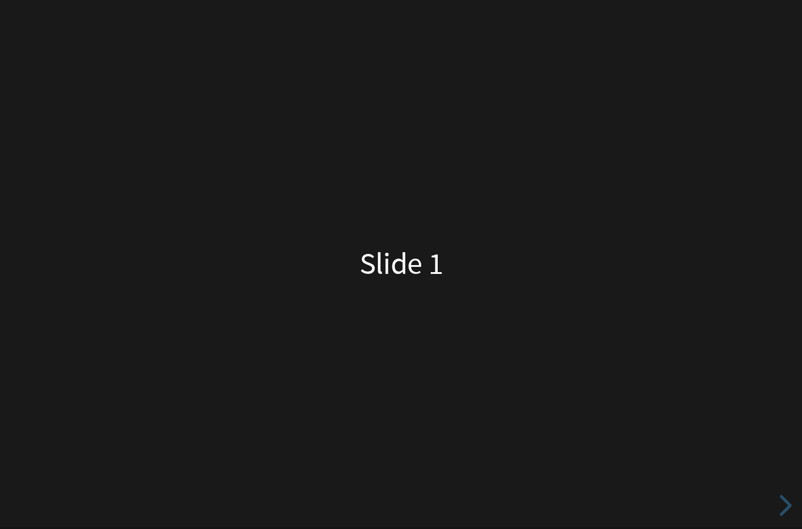
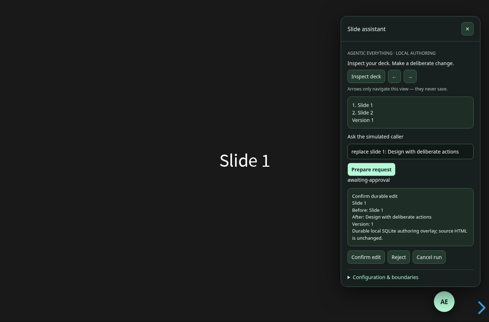

# reveal.js Agentic

The original [reveal.js](https://github.com/hakimel/reveal.js) presentation framework, with a small, governed local authoring assistant powered by Agentic Everything.

- Original slide rendering, keyboard controls, overview and plugins stay intact.
- A draggable **AE** button opens the assistant. Its arrows navigate without saving.
- Inspect the current deck or prepare `replace slide 1: Your title`.
- Review the exact before/after preview and confirm a durable change. Reject or cancel without changing the deck.
- Plain text only: no model-generated HTML, scripts, arbitrary files or external requests.

**The caller is explicitly simulated and deterministic. No paid model API is used.** This is a bounded local, single-operator integration, not a production identity service or a general-purpose presentation-writing model.

| Original host | Governed local edit |
|---|---|
|  |  |

## Run locally

Requires Node 24 and a built Agentic Everything checkout. Use the accepted AE release specified in `docs/architecture.md`; run its documented standard build once if necessary. The existing AE packages are reused, not copied into this project.

```bash
export AE_ROOT=/absolute/path/to/agentic-everything
node agentic/server.mjs                    # read-only
node agentic/server.mjs --allow-write      # opt in to local durable edits
```

Open **http://127.0.0.1:8314**. `PORT` changes the loopback port. `REVEAL_STATE_DIR` selects a private local state directory; the default is `.agentic-state/`.

Only the pinned two-slide `index.html` deck is writable in this integration. The original `demo.html`, examples and distribution remain available unchanged. The upstream development commands are in [the original README](README.upstream.md).

## What persists

| Action | Effect |
|---|---|
| Next/previous slide or overview | Ephemeral browser navigation; does not save |
| Inspect | Authorized read; no edit |
| Confirm replacement | Atomic SQLite deck-overlay and operation-receipt transaction |
| Close panel | Hides the panel; does not confirm or cancel |
| Reject / Cancel run | Stops a pending edit without changing the deck |
| Restart server | Keeps deck/receipts; invalidates in-memory runs and pending approvals |

The adapter never rewrites the original HTML. Every confirmed edit replaces one plain-text slide in the local overlay. Back up `.agentic-state/` while the server is stopped. To return to the upstream deck, stop the server and archive that directory; do not delete it if its receipts or edits are needed.

## Boundaries

The HTTP service binds only to `127.0.0.1`, validates its Host and write Origin, and uses an HttpOnly SameSite local session. It has no login, remote users, tenants or production access management. Do not expose it through a reverse proxy or use it for untrusted multi-user access.

AE owns the single agent loop, tool validation and exact approval binding. The host independently rechecks its current local write permission and deck version. Receipts make identical operations idempotent; unknown outcomes are reconciled rather than blindly retried. Full AE run durability is not claimed.

Run the integration regression tests with `AE_ROOT=/absolute/path/to/agentic-everything node --test scripts/agentic.test.mjs`.

See [architecture](docs/architecture.md), [verification](docs/verification.md) and [MIT license](LICENSE). The complete original upstream attribution and license are retained.
